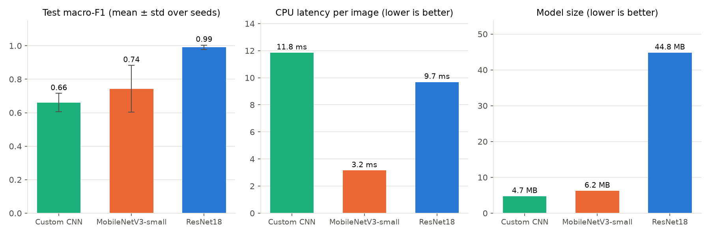
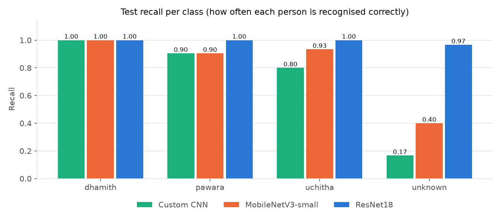
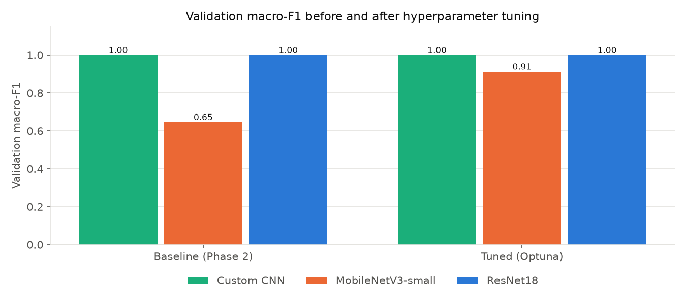
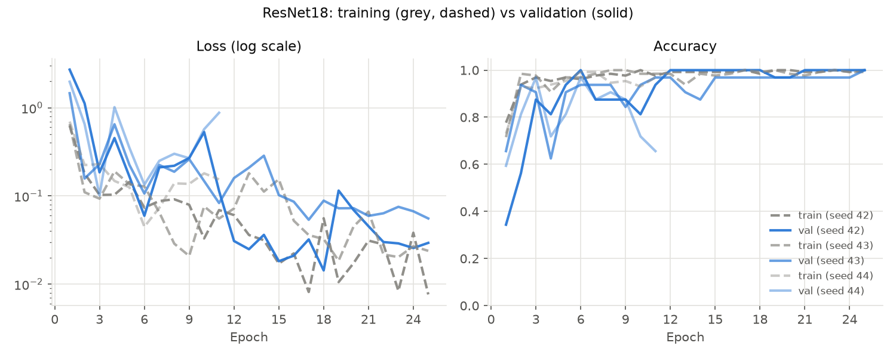
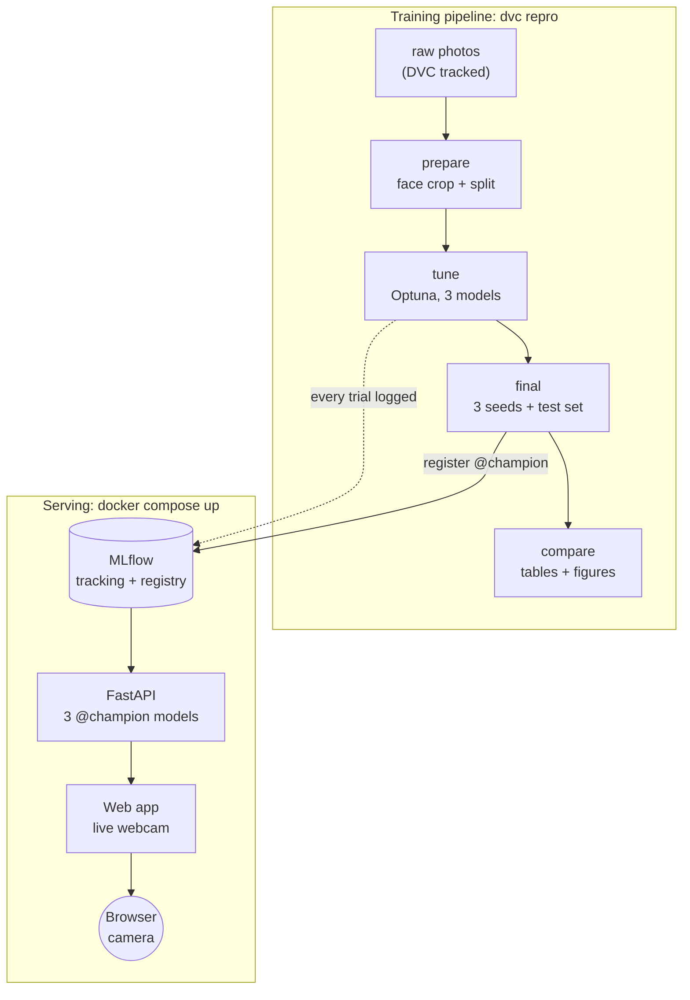

# Find My Friend

Real-time face recognition for a small group of friends, built as a complete MLOps project.
The app looks at a webcam, finds the face and says who it is: **dhamith**, **pawara**, **uchitha** or **unknown**.

Three models are trained and compared on the same data: a **custom CNN** (from scratch),
**MobileNetV3-small** and **ResNet18** (both pretrained on ImageNet). The whole workflow is
reproducible: data and models are versioned with **DVC**, experiments are tracked with **MLflow**,
hyperparameters are tuned with **Optuna**, the best models live in the **MLflow Model Registry**,
and serving runs in **Docker**.

| | |
|---|---|
| Data versioning | DVC (local remote, photos never go to GitHub) |
| Experiment tracking | MLflow (SQLite backend, proxied artifacts) |
| Hyperparameter tuning | Optuna (TPE sampler, median pruner) |
| Model registry | MLflow Model Registry with `@champion` aliases |
| Serving | FastAPI service + MLflow model servers |
| App | Browser webcam page, live predictions and monitoring |
| Deployment | Docker Compose (MLflow, API, app) |

---

## Results

All numbers come from the test set (29 face images), which was never used for training or tuning.
Each model was trained three times (seeds 42, 43, 44); the table shows the mean ± standard deviation.

| Model | Test accuracy | Test macro-F1 | "Unknown" recall | CPU latency | Size | Parameters |
|---|---|---|---|---|---|---|
| **ResNet18** | **0.989 ± 0.016** | **0.990 ± 0.014** | **0.97** | 9.7 ms | 44.8 MB | 11.18 M |
| MobileNetV3-small | 0.759 ± 0.129 | 0.743 ± 0.140 | 0.40 | **3.1 ms** | 6.2 MB | 1.52 M |
| Custom CNN | 0.655 ± 0.049 | 0.660 ± 0.055 | 0.17 | 11.8 ms | **4.7 MB** | 1.17 M |



**What the results show**

- **ResNet18 is the clear winner.** It is almost perfect on new angles and on a stranger it has never
  seen, and it is stable across seeds. It is the model the app uses by default.
- **Recognising the three friends is easy, rejecting strangers is hard.** All models recognise dhamith,
  pawara and uchitha well. The difference is the `unknown` class: the weaker models often call a
  stranger one of the friends.

  

- **The validation set can mislead.** The custom CNN reached a validation F1 of 1.00 but only 0.66 on
  the test set. With 32 validation images, picking the best epoch on validation flatters a weak model.
  This is why the project keeps a separate test set and repeats training with three seeds.
- **Tuning helped MobileNetV3 the most.** Its validation F1 went from 0.65 to 0.91. Optuna found that
  freezing the pretrained backbone and training only the classifier stops it from overfitting.

  

### Training curves (ResNet18)

Train (grey, dashed) and validation (solid) loss and accuracy for the three seeds. More curves and the
confusion matrices for every model are in [`reports/evaluation/`](reports/evaluation).



### Best hyperparameters (Optuna, 20 trials per model)

| Model | Learning rate | Weight decay | Dropout | Batch size | Freeze backbone | Trials (complete / pruned) |
|---|---|---|---|---|---|---|
| Custom CNN | 0.00056 | 0.00635 | 0.37 | 16 | n/a | 9 / 11 |
| MobileNetV3-small | 0.00101 | 0.00002 | 0.05 | 16 | yes | 10 / 10 |
| ResNet18 | 0.00063 | 0.00444 | 0.43 | 16 | no | 13 / 7 |

Optimisation history and parameter importance plots: [`reports/tuning/`](reports/tuning).

---

## How it works



### 1. Data

- 198 phone photos: about 50 of each friend (one burst each, different angles) and 50 of five other
  people (10 each) for the `unknown` class.
- Every photo goes through the same face detector (OpenCV YuNet). The largest face is cropped as a
  square with a 20% margin and resized to 224 × 224. The live app uses exactly the same code, so the
  models see webcam frames the same way they saw the training data.
- **The split is designed to avoid leakage.** Burst frames next to each other are almost identical, so
  a random split would put near-copies in train and test. Instead:
  - friends: frames are split **in burst order** (first 70% train, next 15% validation, last 15% test)
  - unknown: split **by person** (3 people train, 1 validation, 1 test), so the test checks a stranger
    the model has never seen
- Final sizes: train 130, validation 32, test 29 (7 photos skipped because no face was found).
- The result is stored as tensors: `data/train.pt`, `data/val.pt`, `data/test.pt`.

### 2. Pipeline (DVC)

`dvc repro` runs the stages below and only re-runs a stage when its code, data or parameters change.
All settings are in [`params.yaml`](params.yaml).

| Stage | Command | Output |
|---|---|---|
| `prepare` | `python -m src.data.make_dataset` | face crops, `.pt` tensors, `reports/data_stats.json` |
| `tune@<model>` | `python -m src.tune --model <model>` | best hyperparameters, Optuna plots |
| `final@<model>` | `python -m src.evaluate --model <model>` | 3 seeds, test metrics, curves, confusion matrix, registered model |
| `compare` | `python -m src.compare` | comparison table and figures |

Each MLflow run stores the DVC hash of the data and the Git commit, so every model can be traced back
to the exact data and code that produced it.

### 3. Model registry

For each architecture the final stage registers one model as `fmf-<model>` and points the
`@champion` alias at it. The seed is chosen by **validation** score, never by test score, so the
reported test numbers stay honest. Test metrics and CPU latency are saved as tags on the model version.

### 4. Serving

| | MLflow model servers | FastAPI service |
|---|---|---|
| What runs | one REST server per model (ports 5001-5003) | one API with all three models (port 8000) |
| Input | a ready image tensor | any photo; the API finds and crops the face |
| Used by | `serving/mlflow_client.py` | the web app |

FastAPI endpoints: `POST /predict?model=resnet18`, `POST /predict_all`, `GET /health`, `GET /models`,
`GET /stats` and `POST /reload`. `/reload` loads a newly promoted `@champion` without restarting the
service.

If the model's confidence is below a threshold (default 0.6), the answer becomes `unknown`. This is a
simple open-set rule: it is safer to say "I don't know" than to name the wrong person.

### 5. App and monitoring

The web app ([`app/static/index.html`](app/static/index.html)) uses the browser camera, sends about
5 frames per second to the API and draws the face box and name on the video. It can compare all three
models side by side, and a slider changes the "unknown" threshold live.

Every prediction is appended to `logs/predictions.jsonl` (time, model, version, label, confidence,
latency; no images). `GET /stats` and the monitoring panel show the label mix, average confidence and
how often the threshold changed an answer. A drop in confidence is the first sign that the live data
no longer looks like the training data.

---

## Getting started

### Requirements

- Ubuntu (tested), Python 3.12, an NVIDIA GPU for training (CPU works, but slower)
- Docker with Compose v2 for the containers

### Setup

```bash
git clone https://github.com/dhamith99/find-my-friend.git
cd find-my-friend
python -m venv .venv && source .venv/bin/activate

# PyTorch with CUDA (pick the build for your GPU from pytorch.org)
pip install torch==2.5.1 torchvision==0.20.1 --index-url https://download.pytorch.org/whl/cu121
bash scripts/setup.sh          # installs requirements, face detector model, dvc pull
```

> The photos are private and are not on GitHub. `dvc pull` only works if you have access to the DVC
> remote. To use your own data, put one folder per person in `raw/` (plus an `unknown/` folder) and
> run `dvc add raw`.

### Run the full pipeline

```bash
bash scripts/run_pipeline.sh                    # prepare, tune, final, compare (starts MLflow if needed)
bash scripts/run_pipeline.sh -m "message"       # same, then commit and push
dvc metrics show                                # headline numbers
```

### Run locally (three terminals)

```bash
bash scripts/start_mlflow.sh    # MLflow UI + registry   http://127.0.0.1:5000
bash scripts/serve_api.sh       # model API              http://127.0.0.1:8000/docs
bash scripts/serve_app.sh       # web app                http://127.0.0.1:8501
```

MLflow's own model servers (one per model) and a test client:

```bash
bash scripts/serve_mlflow_models.sh
python -m serving.mlflow_client path/to/photo.jpg
```

### Run with Docker

```bash
bash scripts/docker_up.sh       # builds and starts MLflow, API and app
docker compose ps               # all three should be "healthy"
bash scripts/docker_down.sh     # stop
```

The containers use the existing `mlflow.db` and `mlartifacts/`, so all runs and registered models are
available inside Docker. If a port is already in use on your machine, choose another one, for example
`MLFLOW_PORT=5050 bash scripts/docker_up.sh` (`API_PORT` and `APP_PORT` work the same way).

### Tests

```bash
python -m pytest -q     # model shapes, freezing, transforms, train/serve preprocessing match
ruff check .
```

---

## Project structure

```
find-my-friend/
├── raw/                    photos, one folder per class (DVC, not in Git)
├── data/                   face crops + train/val/test .pt tensors (DVC output)
├── assets/                 YuNet face detector (ONNX)
├── params.yaml             every setting: data, face, training, tuning, final, serving
├── dvc.yaml / dvc.lock     pipeline stages and their exact versions
├── src/
│   ├── data/               face.py (detect + crop), make_dataset.py, dataset.py (augmentation)
│   ├── models/             custom_cnn.py, factory.py (MobileNetV3-small, ResNet18)
│   ├── train.py            training loop + MLflow logging
│   ├── tune.py             Optuna study per model (nested MLflow runs)
│   ├── evaluate.py         final training, test evaluation, registry
│   ├── compare.py          comparison table and figures
│   └── inference.py        shared prediction code for the API and app
├── serving/                FastAPI service, MLflow model-server client
├── app/                    web app (webcam page) + OpenCV desktop version
├── docker/                 Dockerfiles for mlflow, api, app (+ optional GPU training)
├── docker-compose.yml
├── scripts/                setup, pipeline, MLflow, serving and Docker scripts
├── tests/                  pytest unit tests
└── reports/                metrics (JSON) and figures used in this README
```

---

## Limitations and lessons learned

- **Lighting.** The models work well in conditions like the training photos but get unsure in very
  different light (in a live test in a darker room, the app answered "unknown" for dhamith). Each
  friend's photos come from one burst in one place, so the models partly learned that setting. The
  test set came from the same bursts, so the 99% score means "new angle, same session", not
  "new day, new light". This is a classic case of distribution shift.
- **General vs. face-specific features.** The pretrained models learned from ImageNet (objects, not
  faces). Systems like Face ID learn a "face fingerprint" from millions of faces and use an infrared
  depth camera, which makes them robust to light, beards and glasses.
- **Small validation set.** With 32 images, one mistake changes accuracy by about 3%, which makes
  epoch selection noisy (see the custom CNN result).
- **One face at a time.** The app labels the largest face in the frame.

### Next steps

1. Collect webcam photos of each person in several lighting conditions and on different days, then
   retrain with `dvc add raw && bash scripts/run_pipeline.sh` and `POST /reload`.
2. Add a fourth model built on a face-recognition network (for example FaceNet embeddings + a simple
   classifier with a distance threshold for strangers).
3. Stronger lighting augmentation (dark, bright, low contrast, noise).
4. Keep one lighting condition completely out of training to get a test score that predicts real use.

---

## Author

Dhamith ([@dhamith99](https://github.com/dhamith99)), HND in Data Science, NIBM.
Thanks to Pawara, Uchitha and the five volunteers in the `unknown` class for their photos.
